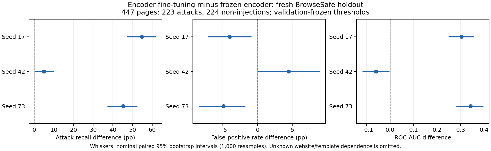

# Supervised MPNet pilot — September 11, 2026

**Status: completed on an NVIDIA A100-SXM4-40GB; all 81 recorded artifact hashes and local prediction checks passed. Checkpoints are saved and the Colab runtime has been released.**

This is a small, controlled test of supervised encoder fine-tuning. It is separate from the earlier contrastive-pair experiment and the three-seed windowing experiment, whose seeds varied only XGBoost. No model is deployed.

## Comparison and data

Both arms use the same public MPNet revision, a linear binary-classification head, the same page order and initial head for each seed, and a page-level binary cross-entropy loss. One arm freezes the encoder; the other updates all encoder parameters. Seeds are **17, 42 and 73**. The existing seed-42 MPNet–XGBoost checkpoint remains a historical reference, with its original threshold.

The input is **unchanged raw HTML**, retaining comments, attributes, scripts, and text. All overlapping 382-content-token windows are scored. The maximum window logit is the page logit, and one loss is applied per page. No document label is copied to every window. Fine-tuning finds the maximum without gradients, then recomputes that window with gradients. With dropout disabled in both arms, this is a subgradient of the max-pooled loss, apart from finite-precision batching differences. A runnable check compares this method with a full computation graph.

| Partition | Pages | Attacks | Non-injections | HTML windows |
|---|---:|---:|---:|---:|
| Training | 256 | 128 | 128 | 18,409 |
| Validation | 192 | 96 | 96 | 14,823 |
| Fresh final holdout | 447 | 223 | 224 | 34,189 |

All inputs come from [BrowseSafe-Bench](https://huggingface.co/datasets/perplexity-ai/browsesafe-bench), revision `b506fb5bc7fd4472c8738055a67a0ef6406afdc9`. Using both classes from one source removes the preceding experiment's across-source label imbalance from this comparison; it does not remove possible website, template or length confounding.

Training and validation retain their earlier partition membership. Character 3–5-gram TF-IDF cosine at least 0.90 rejects overlap with reserved previous partitions and within the new pilot. A fixed hash order selects 128 training and 96 validation pages per class. The holdout includes all eligible official-test indices **1600–2099**, beyond both earlier experiments' prefixes; 53 of 500 candidates are excluded. Prior test text is used only for overlap rejection. No prior test score enters training or model selection.

## Label review

BrowseSafe supplies machine-generated page labels, not independently verified attack-span labels. A deterministic bounded review inspected four selected training pages per class, along with previously diagnosed validation examples.

- `train/451`: explicit instruction in a hidden form field; retaining raw HTML fixes its removal by text extraction.
- `train/1465`: an instruction to forward sensitive reports appears in an `aria-label`. The English lexical locator initially missed it, illustrating why absence of a keyword match is not evidence of an incorrect label.
- `train/903`: benign networking documentation uses “override”; keyword presence alone does not establish injection.
- `train/1377`, `train/636`, and `train/403`: non-injection examples contain urgent account notices, useful counterexamples to urgency-only detection.
- `train/513`: an off-domain resource link occurs in an attribute; attack intent is not independently established by this bounded review, and its source label remains weak supervision.
- `train/1567`: full HTML contains account notices and official-domain links without a clearly established attack payload or intent. It is **quarantined, not relabeled or declared a confirmed label error**. The fixed sampling rule selects the next eligible positive, `train/1865`.

The first unscored preparation is preserved in `results/supervised_pilot_20260911/pilot_before_label_review/`. The final preparation was frozen after quarantine at **2026-09-11 06:04:18 UTC**, before any model scoring. Reviewed benign quotation example `train/1072` remains in validation. No complete manual annotation study is claimed.

## Training and evaluation rules

- User-requested **NVIDIA A100**; the runner refuses CPU and other GPUs. CUDA float16 autocast with scaling; float32 parameters.
- At most two epochs, four pages per optimizer step, encoder learning rate `1e-5`, head learning rate `1e-3`, AdamW weight decay `0.01`, gradient norm clipped to 1.
- Validation chooses the epoch by recall at empirical FPR at most 5%, then ROC-AUC; earliest epoch breaks ties. One non-improving epoch stops training.
- Each threshold maximizes validation recall under that same budget; highest threshold breaks ties. With 96 negatives, at most **four validation false positives** are permitted. This is an exploratory budget, not a production safety target or guarantee on new data.
- All six checkpoints and thresholds must be frozen before the first holdout prediction. Report all seeds, including negative results. The primary comparison is paired holdout recall difference, always accompanied by actual holdout FPR; AUC, average precision and balanced accuracy are secondary.
- The final evaluation consumes this holdout. It cannot subsequently be reused as an untouched test for another model choice.

Max pooling can learn useful local evidence, but cannot resolve relationships across distant windows. This pilot does not evaluate downstream attack success, independently verify every source label, or establish generalization outside BrowseSafe. The detector remains a research component alongside independent authorization controls.

## Measured results

All six checkpoint selections were frozen at **06:21:11 UTC**; holdout evaluation completed at **06:25:55 UTC** on September 11. Rates below use validation-selected thresholds on the same 447 holdout pages. No winning seed is selected.

| Seed | Frozen AUC | Fine-tuned AUC | Frozen recall | Fine-tuned recall | Frozen FPR | Fine-tuned FPR |
|---|---:|---:|---:|---:|---:|---:|
| 17 | 0.5316 | 0.8353 | 7.17% | 61.88% | 6.25% | 2.23% |
| 42 | 0.5264 | 0.4668 | 5.38% | 10.31% | 4.02% | 8.48% |
| 73 | 0.5158 | 0.8584 | 5.83% | 51.12% | 5.36% | 0.45% |

Fine-tuning improves recall and reduces false positives for seeds 17 and 73. Seed 42 has worse AUC and exceeds the exploratory 5% FPR budget on the holdout. This is evidence that supervised fine-tuning can help this small comparison, with substantial training-seed instability; it does **not** establish a reliable improvement across seeds.

| Seed | Recall difference, pp (nominal 95% interval) | FPR difference, pp (nominal 95% interval) | AUC difference (nominal 95% interval) |
|---|---:|---:|---:|
| 17 | +54.71 [47.09, 61.88] | −4.02 [−7.14, −0.89] | +0.3037 [0.2483, 0.3558] |
| 42 | +4.93 [0.45, 9.87] | +4.46 [0.00, 8.93] | −0.0596 [−0.1174, −0.0021] |
| 73 | +45.29 [37.22, 52.47] | −4.91 [−8.48, −1.79] | +0.3426 [0.2814, 0.3963] |

Differences are fine-tuned minus frozen; negative FPR differences are favorable. Intervals use 1,000 paired, class-stratified document bootstrap resamples. They assume independent pages and omit unknown website/template dependence, source-label uncertainty and broader training variation. They are nominal, not a guarantee of generalization. Fine-tuned false-positive counts are **5, 19 and 1 out of 224**, respectively.



The unchanged MPNet–XGBoost seed-42 baseline from the earlier audited run obtains AUC **0.5695**, recall **12.56%** (28/223), and FPR **5.80%** (13/224) at its original threshold. Its training data, classifier and input extraction differ, so it is a contextual reference rather than the controlled encoder ablation. This is the earlier audited base model, distinct from the contaminated historical fine-tuned checkpoint discussed in the original claim audit.

The two-epoch, 256-page budget does not establish the best achievable result for either arm. Keep the base model as the research baseline. A subsequent experiment should use training and validation to investigate the seed instability and adequate convergence, predefine its choices, and reserve another untouched holdout. This holdout is now consumed. None of these models is justified as a standalone security gate.

## Execution and verification

Runner: `training/supervised_pilot.py`. Frozen source, inputs, protocol and exclusions: `results/supervised_pilot_20260911/pilot/`. Portable notebook: `notebooks/colab_supervised_pilot.ipynb`.

Input bundle: `notebooks/supervised_pilot_inputs.tar.gz`, SHA256 `7b5011d51c5532556efb9730289f8351602dcc7c5e035b825a27df644b647e65`.

Official [Google Colab CLI](https://github.com/googlecolab/google-colab-cli) **0.6.0**, with **jupyter-kernel-client 0.15.0**: version 1.0.2 removed the `KernelClient` interface expected by this CLI release. Installed using `uv tool install --force --with 'jupyter-kernel-client<1' 'google-colab-cli==0.6.0'`. OAuth grants Colab and identity access; unrelated Drive and Cloud resource scopes were left unchecked. CLI session: `mpnet-supervised-a100`. The earlier browser-created A100 was released before allocating this session.

```sh
colab exec -s mpnet-supervised-a100 --timeout 14400 -f notebooks/colab_supervised_pilot.ipynb
```

The runtime produced `/content/supervised_pilot_complete.tar` (2,187,632,640 bytes; SHA256 `5ad07e2a7f71618715eeb94edc0b14a3a201cfbc0b173ad60fd37fca2d419ec1`). All files were retrieved individually under `results/supervised_pilot_20260911/completed/` to avoid a second large local archive. The executed notebook is `notebooks/colab_supervised_pilot_output.ipynb`: all seven stages have their expected completion output, no error outputs, and unchanged source. CLI 0.6.0 leaves execution-count fields null; the notebook is retained as emitted. Verify with:

```sh
.venv/bin/python scripts/verify_supervised_pilot.py results/supervised_pilot_20260911/completed/mpnet_supervised_pilot
```

This command passed at **06:37:07 UTC**, checking all 81 recorded hashes, full token coverage, saved linear-head and historical XGBoost prediction replay, validation thresholds and epoch selection, paired training orders, counts, A100 identity, and nominal paired bootstrap intervals. It does not independently repeat full GPU encoder training or inference. Results are in `independent_verification.json`; the verified figure was visually inspected. The CLI confirmed session termination after verification.

Local disk exhaustion interrupted artifact download twice; hash checks identified incomplete files and downloads resumed without retraining or rescoring. Three redundant archives from the earlier experiments were removed only after every archived file matched the preserved extracted evidence. `results/supervised_pilot_20260911/duplicate_archive_cleanup.json` records those checks. All extracted evidence and model checkpoints remain intact.
