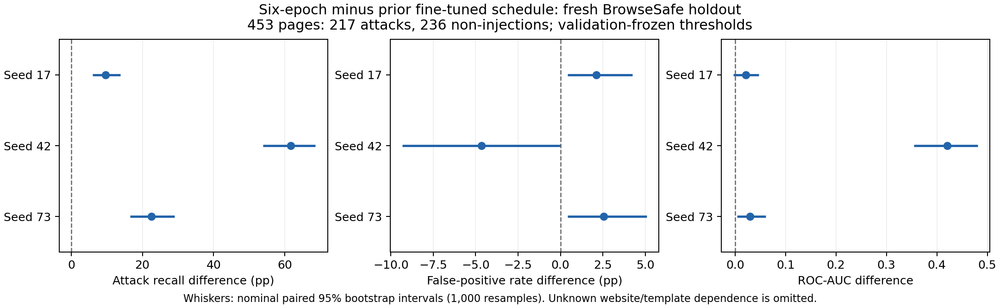
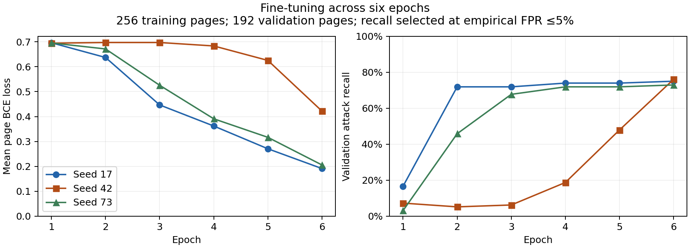

# MPNet fixed-schedule follow-up — September 11, 2026

**Completed and locally verified on an NVIDIA A100-SXM4-40GB. Three revised inference packages are saved. All three seeds improve holdout recall and meet the declared empirical FPR criterion. The A100 was terminated after retrieval and verification; backend assignment count is zero. The experiment heartbeat is paused.**

The user approved packaging the prior weights, diagnosing seed instability, and a controlled correction across seeds. This run extends supervised training to six epochs, with a disclosed numerical repair. It does not validate the paper's original contrastive over-defense claim or establish standalone security-gate readiness.

## Verified comparison

All values below use the **same 453-page BrowseSafe holdout: 217 attacks and 236 non-injections**, with each model's threshold selected on validation only. The prior 447-page pilot holdout is a different, already consumed dataset.

| Seed | Prior AUC | Revised AUC | Prior recall | Revised recall | Prior FPR | Revised FPR |
|---|---:|---:|---:|---:|---:|---:|
| 17 | 0.8128 | 0.8341 | 59.45% | 69.12% | 0.42% | 2.54% |
| 42 | 0.4532 | 0.8732 | 4.61% | 66.36% | 9.32% | 4.66% |
| 73 | 0.8360 | 0.8660 | 45.16% | 67.74% | 0.42% | 2.97% |

Revised true positives / false positives are **150/6, 144/11, and 147/7**, versus prior **129/1, 10/22, and 98/1**. The predeclared directional criterion passes: recall improves for every fine-tuned seed and each revised empirical FPR is at most 5%. False positives increase for seeds 17 and 73. No seed is selected for deployment from these test results.

| Seed | Recall change, pp (95% interval) | FPR change, pp (95% interval) | AUC change (95% interval) |
|---|---:|---:|---:|
| 17 | +9.68 [5.99, 13.82] | +2.12 [0.42, 4.24] | +0.0213 [-0.0031, 0.0467] |
| 42 | +61.75 [53.92, 68.66] | -4.66 [-9.32, 0.00] | +0.4200 [0.3541, 0.4811] |
| 73 | +22.58 [16.59, 29.03] | +2.54 [0.42, 5.08] | +0.0300 [0.0037, 0.0611] |

Intervals use 1,000 paired, class-stratified document bootstrap resamples. All recall intervals are positive. The seed-17 AUC interval crosses zero, and the seed-42 FPR interval reaches zero. These are nominal, unadjusted intervals: they omit unknown website/template dependence, label uncertainty and variation across additional training seeds. Revised FPR nominal Wilson 95% upper bounds are **5.43%, 8.15%, and 5.99%**. Thus empirical FPR below 5% does not establish population FPR below 5%.

The six-epoch frozen-encoder controls have AUC **0.5066/0.5435/0.5066**, recall **5.07/8.29/3.23%**, and FPR **7.20/5.08/3.81%**. The preserved historical base MPNet–XGBoost reference has AUC **0.5699**, recall **14.29%**, and FPR **3.39%**. Its different training data and extraction make it contextual evidence; the paired schedule comparison above is the primary comparison. The base encoder remains a research baseline.



## Diagnosis and correction

The original diagnosis used training and validation only. Seed 42's first two epoch losses were **0.6946 → 0.6972**, while the other seeds improved. Encoder parameters did update. Its selected validation checkpoint had a median top-two-window logit gap of **0.00075**, compared with **0.0421/0.0454** for seeds 17/73. Those selected checkpoints came from different epochs, so this was a diagnostic clue, not proof of a pooling, label or optimizer defect. Seed 42's validation AUC rose in epoch two while recall under the FPR budget fell, causing the original selection rule to retain epoch one.

With six epochs, seed 42's losses were **0.6946, 0.6972, 0.6972, 0.6834, 0.6254, 0.4219**. Its validation recall rose to **76.04%**, versus **7.29%** at the prior selected checkpoint. All three revised fine-tuned models select epoch six, with validation recall **75.00/76.04/72.92%**. Their selected median logit gaps are **0.00503/0.03092/0.02336**. This supports insufficient training duration as a contributor for seed 42 in this setup; it does not isolate a universal cause or prove convergence. Model-winning windows are not annotated attack spans.



## Frozen protocol

- MPNet revision: `e8c3b32edf5434bc2275fc9bab85f82640a19130`; BrowseSafe revision: `b506fb5bc7fd4472c8738055a67a0ef6406afdc9`.
- Unchanged training: **256 pages, 128/class; 18,409 windows**. Unchanged validation: **192 pages, 96/class; 14,823 windows**.
- Six fixed epochs replace the original at-most-two epochs with early stopping. Keep the best validation checkpoint. Same seeds **17/42/73**, head initialization and page orders, raw HTML, complete overlapping 382-token windows (96-token overlap), max-window page BCE, disabled dropout, AdamW, learning rates, four-page batches, clipping and float16 precision. Both frozen and fine-tuned encoder arms remain.
- Select highest validation recall at empirical FPR ≤5%, then AUC, then earliest epoch. Highest threshold breaks operating-point ties. Validation is reused; no test score enters model or threshold choices.
- Fresh candidates were all 500 pinned official-test rows at indices **2100–2599**. Before scoring, **47** were excluded against **7,870 prior inputs** or earlier retained candidates using normalized raw/extracted/first-window exact matches and character-TF-IDF cosine ≥0.90. The retained **453 pages contain 34,449 windows**. Lexical screening does not establish semantic or template independence.
- Original input freeze: **07:33:59 UTC**. Numerical amendment freeze: **08:30:17 UTC**, before any holdout scoring. Every first-two-epoch validation score, decision and page order reproduced exactly in all six trials. All twelve old/new checkpoint hashes and thresholds were frozen before evaluation; the recovered run's freeze is **09:46:06 UTC**.

Weak source labels, a small single-source training set, unknown website/template families and reused validation limit generalization. Full raw-token coverage proves the input was retained, not that the model recognized every attack. No label, template or source defect is claimed as the confirmed cause of the original seed result.

## Numerical failure and amendment

The original six-epoch attempt stopped at seed 17 update 181 after 180 finite optimizer updates: `clip_grad_norm_(error_if_nonfinite=True)` raised before GradScaler could reduce its scale. The failed run never reached holdout evaluation. Both seed-17 arms' first two epochs matched the original run, and the selected failed checkpoint matched the prior checkpoint bytes. All **118 recorded failed-attempt artifacts** and the failure notebook remain preserved.

The amended runner clears invalid gradients, lets GradScaler skip the invalid attempt and back off, and retries backward on the same retained forward graph. Up to eight retries are allowed; persistent nonfinite gradients abort. No batch is omitted. This uses documented [PyTorch AMP nonfinite-step handling](https://docs.pytorch.org/docs/2.9/notes/amp_examples.html), with bounded same-batch retry added here. Local forced-overflow recovery and persistent-nonfinite rejection checks passed, as did the A100 smoke check before training.

Each of the six trials completed **384 successful optimizer updates**. Fine-tuned seeds 17/42/73 retried **2/2/2 batches**, involving **2/4/2 invalid attempts**; frozen controls had none. Every applied update had finite loss and gradient norm. The overflow occurred beyond the old two-epoch budget and does not explain the earlier seed-42 failure. This is a schedule comparison **with a numerical amendment**, not an unamended one-factor trial.

## Runtime loss and deterministic recovery

The first amended run completed training and package replays but lost its Colab assignment during the prior-model portion of holdout evaluation around **09:00 UTC**. The keep-alive log recorded `invalid_scope` refresh failures. The assignment was confirmed absent and could not be reattached; the exact backend termination cause is not independently established. The CLI's saved-scope override was repaired to retain its existing OAuth grant, and automatic expired-token refresh passed without added permissions.

The final A100 run repeated the **unchanged, already frozen** protocol to recover complete artifacts. All six original checkpoint files reproduced byte for byte. Both retrieved new checkpoints (17/42) and **all 36 captured validation summaries** matched the interrupted run. The original interrupted seed-73 checkpoint was lost before retrieval, so no byte comparison to that file is possible. The final seed-73 package is complete and hash verified. All three final new-model aggregate holdout metrics match the captured partial output.

The 453-page holdout was untouched before the initial choices but partially consumed by the interrupted evaluation. Its final evaluation is a fixed remeasurement for artifact recovery, **not a new model-selection experiment**. No architecture, training, threshold or selection choices changed after test output. This holdout is now consumed.

## Saved weights and reproducibility

Portable packages and their example command are indexed in [INFERENCE.md](../results/supervised_schedule_20260911/completed/mpnet_supervised_schedule_replay/INFERENCE.md). They include local encoder/tokenizer configuration, weights, pooling, linear head, complete-window inference and frozen thresholds. Original prior weights are also packaged. They contain model state for inference, not optimizer state for resuming training.

All six prior/new fine-tuned packages replayed all 192 validation pages on A100: **1,152 predictions**, identical decisions, maximum score error **5.96e-8**. Local verification passed at **10:01:24 UTC**: **238 recorded file hashes**, frozen input identities and full token coverage, all twelve model/threshold freezes, selection rules, saved-head and historical classifier predictions, six-epoch histories, optimizer and window logs, first-two-epoch equivalence, recorded package replays and runtime-recovery evidence. Prior fine-tuned head replay uses saved winning embeddings; local verification does not independently repeat full GPU encoder inference or training.

Run from the repository root:

```bash
HF_HUB_OFFLINE=1 .venv/bin/python scripts/verify_supervised_schedule.py \
  results/supervised_schedule_20260911/completed/mpnet_supervised_schedule_replay
HF_HUB_OFFLINE=1 .venv/bin/python tests/test_supervised_pilot.py
```

- Final notebook: `notebooks/colab_supervised_schedule_replay.ipynb`; executed output has **nine completed code cells, no errors**.
- Evidence root: `results/supervised_schedule_20260911/completed/mpnet_supervised_schedule_replay/`.
- Primary checks: `schedule_verification.json`, `holdout_results.json`, `sha256.json`, `schedule_comparison_frozen.json` within that root.
- Retrieval receipt, notebook verification, 14 stage logs and GPU-closure receipt: `results/supervised_schedule_20260911/`.
- Input bundle SHA256: `2055e0ea584e861e48c065d40eb10099175331c89b8653e115f1cf223c694ffb`.
- Failed and interrupted artifacts remain under `failed/` and `interrupted_recovery/`; the frozen `pilot/` and `recovery/` inputs are preserved.

The 14-page manuscript PDF was rebuilt with Tectonic; both generated figures and affected PDF pages 1 and 10–13 were visually inspected. No commit, push, deployment or model publication was performed. Existing dirty work and staging were preserved. Further model choices belong on validation; the next generalization study needs a separate untouched holdout with stronger source/template provenance and label review.
